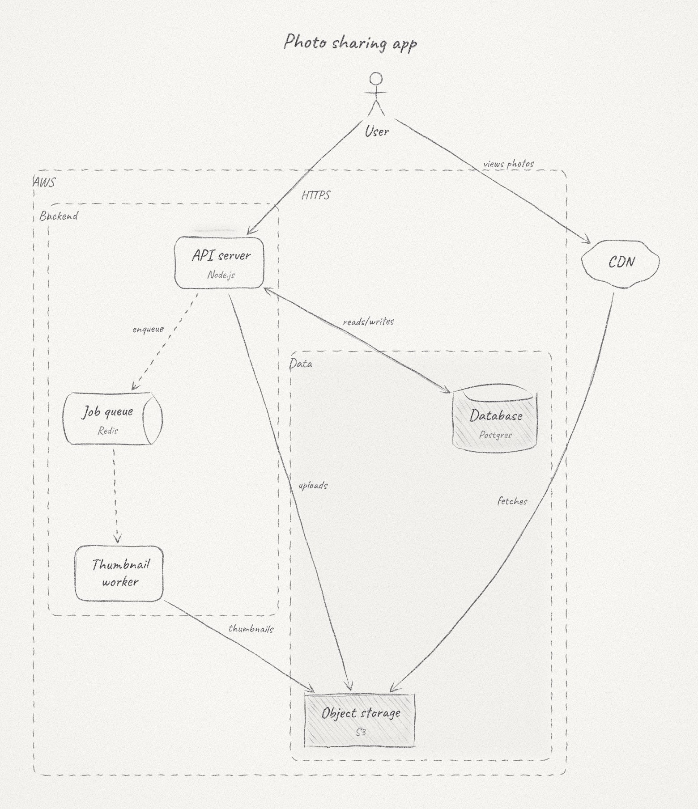

# penciled

An agent skill that turns a small JSON description into a diagram that looks
drawn by hand with a graphite pencil on paper: tapered, wobbly strokes,
layered passes, soft shading, paper grain and the odd eraser smudge.



> Status: early work (v0.1 in progress). All seven shapes, groups, automatic
> layout, shading, paper textures and the validator work. The HTML viewer and
> packaging as an agent skill are next.

## Try it

Needs Node.js 18 or later. No install step, no dependencies.

```
node src/cli.js examples/pencil-test.json -o diagram.svg
```

Open `diagram.svg` in a browser. Add `--seed 123` for a different take on
the same drawing; the same seed always gives the same result.

More inputs, each with its rendered SVG
and a JPEG preview, are in [`examples/`](examples/):

| Example | Shows |
|---------|-------|
| [`web-app`](examples/web-app.jpg) | Groups, nesting, top-to-bottom flow |
| [`shapes`](examples/shapes.jpg) | All seven shapes on grid paper |
| [`event-pipeline`](examples/event-pipeline.jpg) | Manual positions, lined paper, HB pencil |
| [`pencil-variants`](examples/pencil-variants.jpg) | 4B pencil, shading levels, dashed and two-way arrows |

Check an input without drawing it:

```
node src/cli.js validate diagram.json
```

The validator catches mistakes (unknown ids, typos, groups nested in a loop)
and warns about things that will draw badly, such as arrows crossing or
nodes overlapping, with a suggestion for each. The input format and every
check are described in [`schema/README.md`](schema/README.md).

## What it does (planned for v0.1)

- **Architecture diagrams** first: boxes, labels and arrows.
- **Output:** an SVG file plus a self-contained HTML viewer.
- **Validator:** checks the JSON and warns about layout problems
  (overlaps, crossing arrows, labels that don't fit) before drawing.
- **No runtime dependencies.** The handwriting font is embedded.

## Layout

```
schema/     JSON Schema for diagram input
src/        validator and renderer
examples/   sample inputs and rendered outputs
fonts/      embedded handwriting font (open license)
tests/      tests
specs/      plan and design notes
scripts/    dev tools (font rebuild)
```

## Roadmap

| Milestone | Goal |
|-----------|------|
| M0 | Repo setup, license, README |
| M1 | JSON Schema for architecture diagrams |
| M2 | Pencil test: one box and one arrow that look hand-drawn |
| M3 | Full renderer: shading, paper texture, labels |
| M4 | Validator with layout warnings |
| M5 | HTML viewer and examples |
| M6 | Package as an agent skill and publish |

## License

MIT, see [LICENSE](LICENSE).
